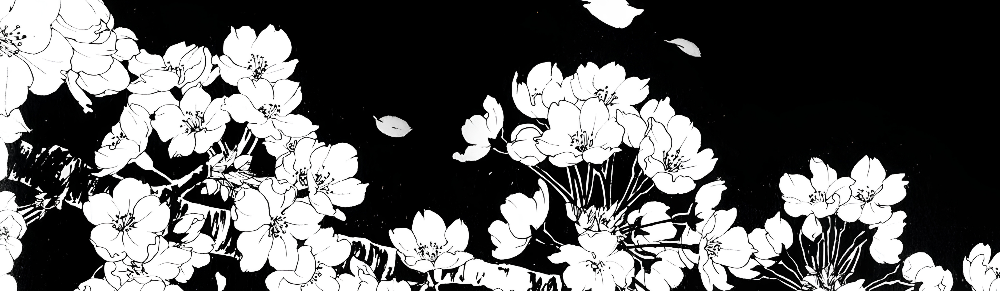

<!-- HERO BANNER -->

  

<!-- INTRODUCTION -->
<h1 align="center">
  Hi 👋, I'm Fatchur Rachman
</h1>

<h3 align="center">
  Informatics Student
</h3>

  Building ideas into meaningful digital experiences.

---

<!-- ABOUT ME -->
<h2 align="center">🚀 About Me</h2>

  I'm an Informatics student passionate about
  technology, software development, and creative problem solving.

- 🎓 Informatics Student
- 💻 Interested in Software Development
- 🌱 Currently learning new technologies
- 🔭 Working on personal and academic projects
- 🎯 Goal: Become a professional developer

---

<!-- CONNECT -->
<h2 align="center">💛 Connect With Me</h2>

  
  
  

---

<!-- TECH STACK -->
<h2 align="center">🛠️ Tech Stack</h2>

  

---

<!-- GITHUB STATS -->
<h2 align="center">📊 GitHub Stats</h2>

  
  

  

---

<!-- ACTIVITY GRAPH -->
<h2 align="center">📈 Activity Graph</h2>

  

---

<!-- PHILOSOPHY -->
<h2 align="center">✦ Philosophy</h2>

  <i>"Great things are built one line of code at a time."</i>

