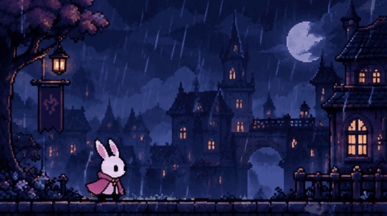

html

  <!-- HERO BANNER -->
  

   

  <h1>Hi, I'm OFATURU 👋</h1>

  <h3>Informatics Student · Developer · Tech Enthusiast</h3>

  

    <i>Turning ideas into code, and code into meaningful experiences.</i>
  

   

  
  
  

    

  

---

<!-- ABOUT ME -->

## 👨‍💻 About Me

I'm an **Informatics Student** passionate about building software, exploring modern technologies, and solving real-world problems through code.

I enjoy combining technical skills with creativity to develop applications and interactive digital experiences.

- 🎓 Studying Informatics.
- 💻 Exploring Software & Web Development.
- 🎮 Interested in Game Development and Interactive Applications.
- 🌱 Continuously learning and improving my technical skills.
- 🚀 Building personal projects and experimenting with new technologies.

---

<!-- CURRENT FOCUS -->

## 🎯 What I'm Focusing On

| Area | Focus |
|:---|:---|
| Web Development | Building modern and responsive web applications |
| Backend Development | Exploring APIs, databases, and server-side development |
| Game Development | Developing interactive experiences with Unity |
| Programming | Improving problem-solving and software engineering skills |

---

<!-- TECH STACK -->

## 🛠️ Tech Stack & Tools

**Languages**

  

**Frameworks & Database**

  

**Development Tools**

  

---

<!-- GITHUB ANALYTICS -->

## 📊 GitHub Analytics

  

  

    

  

---

<!-- ACTIVITY GRAPH -->

## 📈 Contribution Activity

  

---

<!-- CONNECT -->

## 🤝 Let's Connect

I'm always open to connecting with fellow developers, exchanging ideas, and exploring opportunities to collaborate.

  

  

  

    

  <i>"Great things are built one line of code at a time."</i>

    

  **Thanks for visiting my profile!** ✦

